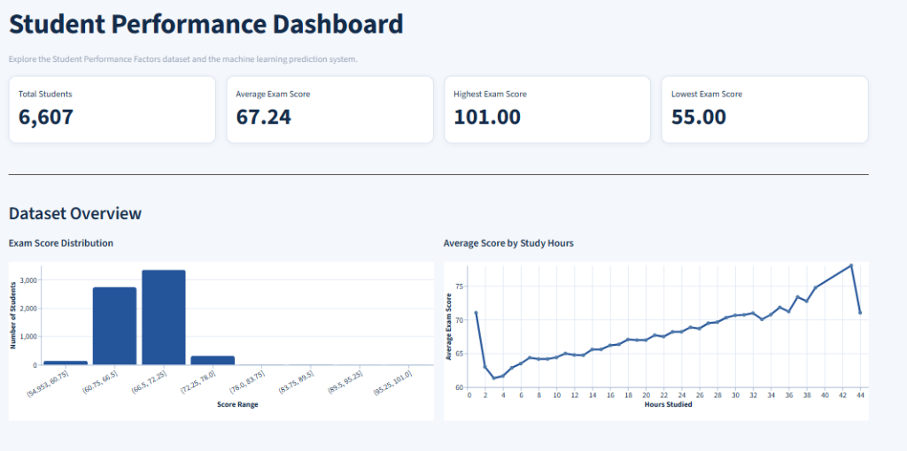
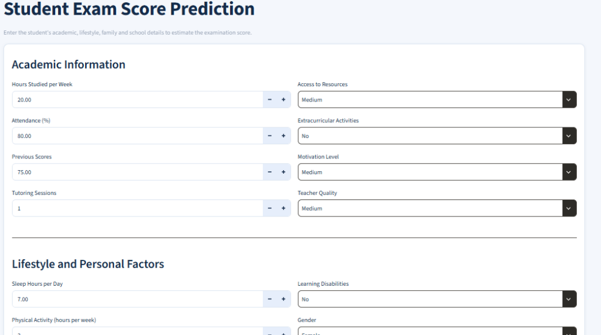
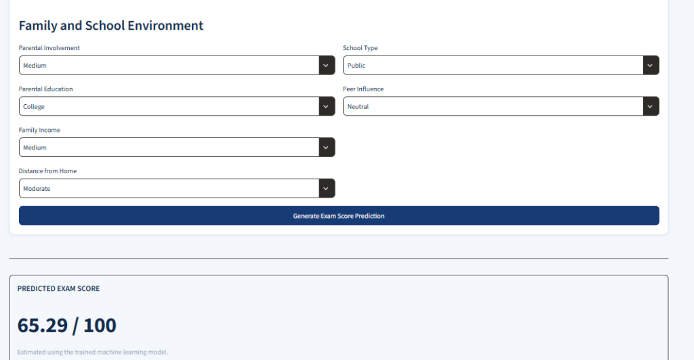
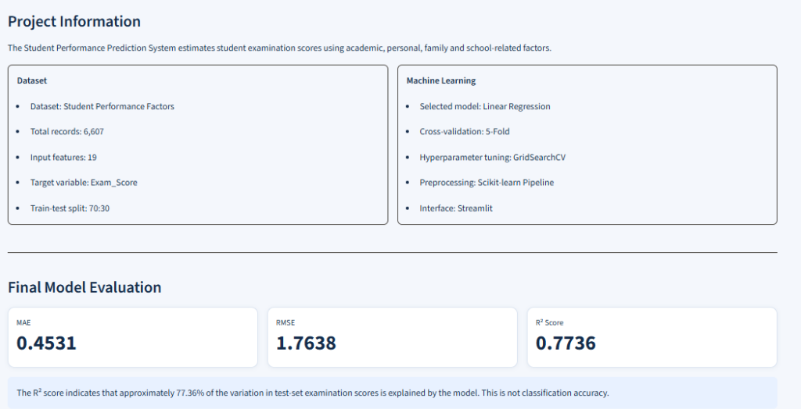

# 🎓 Student Performance Prediction & Factor Analysis

An end-to-end Machine Learning and Data Science project designed to analyze the key determinants of academic success and accurately predict student exam performance. Built with Python, Scikit-Learn, and Streamlit.

---

## 📌 Project Overview

Academic success is influenced by a combination of academic habits, personal motivation, school environment, and socioeconomic factors. This repository provides:
- **Exploratory Data Analysis (EDA):** Deep analysis of factors influencing student scores.
- **Trained Machine Learning Model:** A predictive model trained on student factors and historical metrics.
- **Interactive Web Application:** A Streamlit dashboard (`app_v2.py`) allowing educators, parents, and students to simulate different scenarios and predict performance outcomes in real time.

---

## 📸 Application Screenshots

### 1. Student Performance Dashboard


### 2. Prediction Form (Academic & Personal Factors)


### 3. Real-Time Score Prediction Result


### 4. Project Information & Model Evaluation


---

## 📊 Dataset Overview

The dataset (`dataset/StudentPerformanceFactors.csv`) contains comprehensive student records evaluating various behavioral and demographic factors:

| Feature Category | Features Included |
| :--- | :--- |
| **Study Habits** | `Hours_Studied`, `Attendance`, `Tutoring_Sessions`, `Previous_Scores` |
| **Wellbeing & Lifestyle** | `Sleep_Hours`, `Physical_Activity`, `Motivation_Level` |
| **Socioeconomic & Environment** | `Parental_Involvement`, `Access_to_Resources`, `Internet_Access`, `Family_Income`, `Parental_Education_Level`, `Distance_from_Home` |
| **School & Social Factors** | `Teacher_Quality`, `School_Type`, `Peer_Influence`, `Extracurricular_Activities`, `Learning_Disabilities` |

---

## 📈 Model Performance & Evaluation

The final model was evaluated on unseen test data, achieving high predictive accuracy:

| Metric | Score | Description |
| :--- | :---: | :--- |
| **R² Score** | **0.774** | Explains ~77.4% of the variance in student scores |
| **Mean Absolute Error (MAE)** | **0.453** | Average prediction deviation of less than half a point |
| **Root Mean Squared Error (RMSE)** | **1.764** | Low sensitivity to large outliers |

*Detailed metric logs can be found in [`results/final_model_metrics.csv`](results/final_model_metrics.csv).*

---

## 🗂️ Repository Structure

```text
Student-Performance-Prediction/
├── dataset/
│   └── StudentPerformanceFactors.csv      # Primary dataset
├── models/
│   └── student_performance_model.pkl      # Trained regression pipeline / model
├── notebooks/
│   └── 02_Student_Performance_Factors_EDA.ipynb  # Exploratory Data Analysis & Modeling
├── results/
│   └── final_model_metrics.csv            # Evaluation metrics (R2, MAE, RMSE)
├── screenshots/
│   ├── dashboard.png                      # App dashboard overview
│   ├── model_evaluation.png               # Metrics & evaluation summary
│   ├── prediction_form.png                # Input form for prediction
│   └── prediction_result.png              # Predicted score output
├── .gitignore                             # Git ignore rules
├── app_v2.py                              # Streamlit Web Application (UI v2)
├── README.md                              # Project documentation
└── requirements.txt                       # Project dependencies
```

---

## 🚀 Quick Start Guide

### 1. Clone the Repository
```bash
git clone https://github.com/Mani-vajrala/Student-Performance-Prediction.git
cd Student-Performance-Prediction
```

### 2. Set Up a Virtual Environment
```bash
# Windows
python -m venv venv
.\venv\Scripts\activate

# macOS / Linux
python3 -m venv venv
source venv/bin/activate
```

### 3. Install Dependencies
```bash
pip install -r requirements.txt
```

### 4. Launch the Interactive Web App
```bash
streamlit run app_v2.py
```
Open your browser at `http://localhost:8501` to access the interactive student performance simulator.

---

## 🛠️ Tech Stack
- **Language:** Python
- **Data Manipulation:** Pandas, NumPy
- **Machine Learning:** Scikit-Learn, Joblib
- **Visualization:** Matplotlib, Seaborn
- **Web Dashboard:** Streamlit

---

## 👤 Author
- **Mani Vajrala** ([GitHub Profile](https://github.com/Mani-vajrala))
